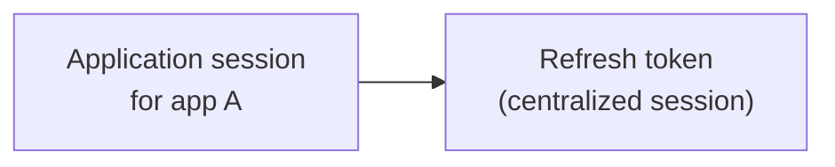

# astro-better-mermaid

Astro integration that renders ` ```mermaid ` code blocks to inline SVG at build time. No client-side JavaScript is shipped to the browser.

Rendering happens via [svgdom](https://github.com/svgdotjs/svgdom), a headless DOM shim that convinces mermaid it is running in a browser. It is not running in a browser.

## Installation

```
npm install astro-better-mermaid mermaid@11
```

`mermaid` is a peer dependency, so install it alongside this package. `svgdom` comes with this package.

The package requires Mermaid `11`. Mermaid `12` flowcharts don't render under svgdom, so the peer dependency allows only `11.x`, plus the Mermaid `13` alpha. For more information, see [Mermaid v13 (Experimental)](#mermaid-v13-experimental).

## Usage

```ts
// astro.config.ts
import { defineConfig } from 'astro/config';
import mermaidSSR from 'astro-better-mermaid';

export default defineConfig({
  integrations: [mermaidSSR()],
});
```

Mermaid code blocks in your Markdown and MDX files will be replaced with pre-rendered SVG wrapped in a `<div class="mermaid">` at build time. Blocks that fail to render are left as fenced code blocks.

### Line breaks in labels

In flowcharts, state diagrams, and class diagrams, a label with an HTML tag such as `<br/>` or `<span>` renders with no text. Sequence diagrams render HTML in labels. When a diagram other than a sequence diagram contains a common formatting tag, such as `<br/>` or `<b>`, the build prints a warning that names the page. For a line break, use a Mermaid markdown string with a real newline in the label:

````md

````

Text that only looks like a tag, such as the placeholder `<id>`, also renders with no text, and the build doesn't warn about it. Write the angle brackets as Mermaid entity codes instead: `ent:#lt;id#gt;`.

### Supported diagrams

Every Mermaid `11` diagram type renders except mindmap and architecture diagrams. Mermaid lays out both types with cytoscape, which needs a canvas that svgdom doesn't provide. The plugin skips both types, prints a warning, and leaves the source as a code block.

When a diagram fails to render, the warning names the page, the diagram type, and the diagram's position on the page, followed by the first lines of Mermaid's error. The page shows the diagram source instead.

## Options

```ts
mermaidSSR({
  theme: 'default',       // mermaid theme — 'default', 'dark', 'neutral', 'forest'
  securityLevel: 'loose', // mermaid securityLevel
  titleFix: true,         // parse title="..." from code block meta as a caption
  injectCSS: true,        // inject the bundled stylesheet automatically
  cache: true,            // cache rendered diagrams on disk between builds
  cacheDir: 'node_modules/.cache/astro-better-mermaid', // where the cache lives
  lightbox: false,        // open each diagram in an enlarged dialog on click
  experimentalV13: false, // allow rendering with an installed mermaid 13 alpha
})
```

Rendered diagrams are cached by Mermaid version, theme, security level, and diagram source, so unchanged diagrams skip rendering on later builds. Releases that change how diagrams render also invalidate the cache. Each SVG id comes from the diagram's position on the page and a hash of its source, so output is stable from build to build.

### Diagram titles

With `titleFix` enabled, you can add a caption to any code block via its meta string:

````
```mermaid title="Authentication flow"
...
```
````

Captions on mermaid blocks appear below the diagram; captions on other code blocks appear above.

### Lightbox

When `lightbox` is `true`, a reader can click a diagram, or tab to its **Enlarge** button, to open the diagram in a full-screen dialog. The dialog comes from [`astro-better-lightbox`](https://better-static-sites.github.io/content/lightbox) and needs no client-side JavaScript. The diagram title names the dialog for screen readers.

The dialog holds a second copy of the SVG, with every id suffixed by `-zoom`, so the copy never collides with the original. The copy adds about 30 KB of uncompressed HTML for a typical diagram. The copy can grow up to 2.5 times the diagram's natural width. To change the limit, set `--abl-lightbox-max-zoom` on `.abl-lightbox`.

When `injectCSS` is `true`, the integration also injects the lightbox styles. Otherwise, import `astro-better-lightbox/styles.css` yourself.

## Mermaid v13 (Experimental)

Mermaid v13 is an alpha. Don't use it in production. Output, theming, and APIs change between alpha builds.

Mermaid v13 renders without a DOM, so the package skips svgdom and its browser shims when v13 is installed. v13 has no third-party runtime dependencies. To try v13, install an exact alpha build and pass **`experimentalV13`**:

```shell-session
npm install mermaid@13.0.0-alpha.3 --save-exact
```

```ts
mermaidSSR({ experimentalV13: true })
```

The installed `mermaid` version picks the renderer, because the package must import mermaid before Astro reads plugin options. When mermaid `13` is installed without **`experimentalV13`**, the build fails with a message that names the installed version. With **`experimentalV13`**, the build logs one warning that the output comes from an alpha.

v13 output differs from v11 output in the following ways:

* The SVG has no `id`, and the root carries `data-mermaid-version`. The bundled stylesheet themes v13 diagrams through `--mermaid-*` custom properties on `svg[data-mermaid-version^="13"]`, with the same light and dark palette as v11. When you maintain your own copy of the styles, copy the v13 block too.
* v13 ignores **`securityLevel`**, so the package doesn't pass the option to v13.
* Labels can contain HTML such as `<br/>`, so the package doesn't warn about HTML in labels.
* Mindmap and architecture diagrams render.

To switch over when v13 is stable, install the stable release and remove **`experimentalV13`** once the package drops the flag.

## Styles

The integration injects a default stylesheet that covers light mode and dark mode. Dark mode is driven by a `.dark` class on an ancestor element (the Tailwind `darkMode: 'class'` convention).

To use your own styles instead, set `injectCSS: false` and import the bundled CSS as a starting point:

```css
@import 'astro-better-mermaid/style.css';
```

`astro-better-mermaid/styles.css` resolves to the same file, for parity with releases before 0.1.2.

### Custom cluster fill colors

Mermaid's `style X fill:#color` directive injects `!important` inline styles that block CSS overrides. This integration strips the `!important` from cluster background rects and stores the original color in a `data-fill-color` attribute. The default stylesheet handles `#999` and `#944`. For other colors, add rules of the form:

```css
.cluster > rect[data-fill-color="#abc"] { fill: your-color !important; }
.dark .cluster > rect[data-fill-color="#abc"] { fill: your-dark-color !important; }
```

## Upgrading to 0.4.0

The package now requires Mermaid `11`. Earlier releases accepted Mermaid `10` and later.

Gantt, C4, sankey, block, and treemap diagrams now render. Earlier releases left these diagrams as code blocks. Mindmap and architecture diagrams are skipped with a warning instead of failing to render.

Warnings now name the page and the diagram type, and count diagrams on a page from 1 instead of 0. The build also warns when a diagram contains HTML that renders with no text. For more information, see [Line breaks in labels](#line-breaks-in-labels).

## Upgrading to 0.3.0

Labels now fit their shapes: multi-line labels get room for every line, and text is centered in cylinders and other shapes and on edge label backgrounds. Rendering changed, so cached diagrams render again after you upgrade.

If you set `injectCSS: false` and copied the stylesheet into your own CSS, update your copy:

1. Remove `transform: translateY(16px) !important;` from the `.edgeLabel rect` rules in both themes. It made up for the old edge label measurement and now pushes label backgrounds below their text.
1. Color `.loopText` and `.sectionTitle` like body text in both themes, so `alt`, `loop`, and `else` conditions in sequence diagrams stay readable. The light theme used to color `.loopText` almost white.

## Using the remark plugins directly

If you prefer to wire up the remark plugins yourself:

```ts
import { remarkMermaidSSR, mermaidTitleFix } from 'astro-better-mermaid';

export default defineConfig({
  markdown: {
    remarkPlugins: [
      mermaidTitleFix,
      [remarkMermaidSSR, { theme: 'default' }],
    ],
  },
  vite: {
    ssr: { external: ['svgdom', 'mermaid'] },
  },
});
```

`svgdom` and `mermaid` must be listed in `vite.ssr.external` — they are Node-only packages and cannot be bundled into client output.

## Sätteri

When `markdown.processor` is a [Sätteri](https://satteri.bruits.org/) processor, the integration adds its Sätteri plugins to that processor instead of registering remark plugins. Pass the same processor to `mdx()` so MDX files get them too:

```ts
import mdx from '@astrojs/mdx';
import { satteri } from '@astrojs/markdown-satteri';
import mermaidSSR from 'astro-better-mermaid';

const processor = satteri();

export default defineConfig({
  markdown: { processor },
  integrations: [mdx({ processor }), mermaidSSR()],
});
```

To wire the plugins yourself, use `mermaidTitle` and `mermaidSSR` from `astro-better-mermaid/satteri`, in that order. They take the same options as the remark plugins.

