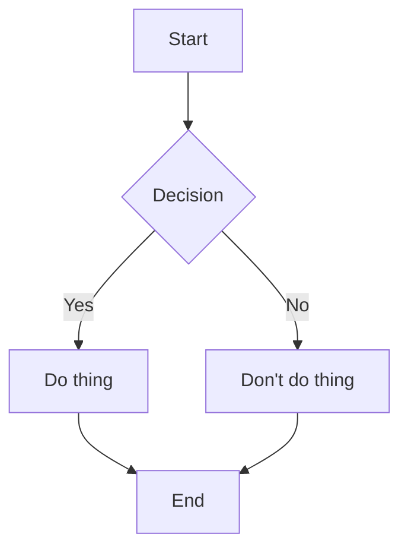
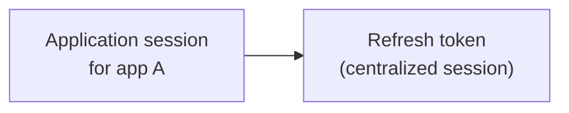
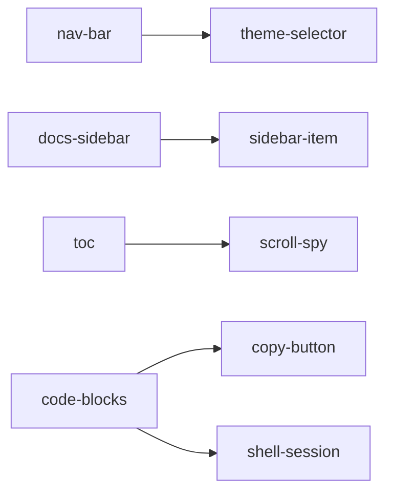

import PkgMeta from 'src/components/PkgMeta.astro';

An Astro integration that pre-renders Mermaid diagrams to inline SVG at build time.
No client-side JavaScript, because diagrams are static SVG in the output HTML.
No heavyweight browser CLI required, either, because this uses `svgdom` (just a few MBs, a couple of orders of magnitude lighter than Playwright) to render SVGs.

<PkgMeta pkg="astro-better-mermaid" />

## Installation

```shell-session
npm install astro-better-mermaid mermaid@11
```

The package requires Mermaid `11`. Mermaid `12` flowcharts don't render under svgdom, so the peer dependency allows only `11.x`, plus the Mermaid `13` alpha. For more information, see [Mermaid v13 (Experimental)](#mermaid-v13-experimental).

## Setup

In `astro.config.ts`:

```ts
import mermaidSSR from 'astro-better-mermaid';

export default defineConfig({
  integrations: [
    mermaidSSR({
      theme: 'default',
    }),
  ],
});
```

## Options

| Option | Type | Default | Description |
|--------|------|---------|-------------|
| `theme` | `string` | `'default'` | Mermaid theme: `default`, `dark`, `neutral`, `forest` |
| `titleFix` | `boolean` | `true` | Show `title="..."` from the code fence meta as a caption below the diagram |
| `injectCSS` | `boolean` | `true` | Auto-inject default styles |
| `securityLevel` | `string` | `'loose'` | Mermaid `securityLevel` setting |
| `cache` | `boolean` | `true` | Cache rendered diagrams on disk between builds |
| `cacheDir` | `string` | `'node_modules/.cache/astro-better-mermaid'` | Where cached diagrams live, relative to the working directory |
| `lightbox` | `boolean` | `false` | Open each diagram in an enlarged dialog on click. For more information, see [Lightbox](/content/lightbox) |
| `experimentalV13` | `boolean` | `false` | Allow rendering with an installed Mermaid `13` alpha. Not for production. For more information, see [Mermaid v13 (Experimental)](#mermaid-v13-experimental) |

## Usage in MDX

Write standard Mermaid fences in your MDX files:

````md

````

### Line breaks in labels

In flowcharts, state diagrams, and class diagrams, a label with an HTML tag such as `<br/>` or `<span>` renders with no text. Sequence diagrams render HTML in labels. When a diagram other than a sequence diagram contains a common formatting tag, such as `<br/>` or `<b>`, the build prints a warning that names the page. For a line break, use a Mermaid markdown string with a real newline in the label:

````md

````

Text that only looks like a tag, such as the placeholder `<id>`, also renders with no text, and the build doesn't warn about it. Write the angle brackets as Mermaid entity codes instead: `ent:#lt;id#gt;`.

### Supported diagrams

Every Mermaid `11` diagram type renders except mindmap and architecture diagrams. Mermaid lays out both types with cytoscape, which needs a canvas that svgdom doesn't provide. The plugin skips both types, prints a warning, and leaves the source as a code block.

When a diagram fails to render, the warning names the page, the diagram type, and the diagram's position on the page, followed by the first lines of Mermaid's error. The page shows the diagram source instead.

## Live example



## How it works

The integration registers a remark plugin (`remarkMermaidSSR`) that transforms
` ```mermaid ` fences into inline SVG during the Astro build. It uses `svgdom`
to render Mermaid server-side without a headless browser.

To use the remark plugin directly without the integration:

```ts
import { remarkMermaidSSR } from 'astro-better-mermaid';

export default defineConfig({
  markdown: {
    remarkPlugins: [[remarkMermaidSSR, { theme: 'neutral' }]],
  },
});
```

## Mermaid v13 (Experimental)

Mermaid v13 is an alpha. Don't use it in production. Output, theming, and APIs change between alpha builds, so pin an exact version.

Mermaid v13 renders without a DOM and has no third-party runtime dependencies. When v13 is installed, the package skips svgdom and its browser shims. This site renders with v13, so we can test the alpha on a real site.

### Rendering Speed

v13 renders about 25 times faster than mermaid 11 under svgdom once the renderer warms up, and about 11 times faster on the first render. The following table compares the renderers on 40 diagrams, with the disk cache off, on an Apple Silicon laptop with Node.js `26`:

| Renderer | Startup | First render, per diagram | Warm render, per diagram |
|---|---|---|---|
| Mermaid 11 in a headless browser (WebKit) | 650 ms to launch the browser and load mermaid | 13 ms | 10 ms |
| `astro-better-mermaid` with mermaid 11 and svgdom | 380 ms | 16 ms | 12 ms |
| `astro-better-mermaid` with mermaid 13 alpha | 65 ms | 1.4 ms | 0.44 ms |

A tool that starts a browser for each diagram spends about 700 ms per diagram, about 40 times slower than svgdom and about 500 times slower than v13. A browser that stays open renders about as fast as svgdom, but the browser has to be downloaded, installed, and launched first.

### Switch to v13

1. Install `astro-better-mermaid` `0.6.0` or later and an exact mermaid alpha build:

   ```shell-session
   npm install astro-better-mermaid@latest mermaid@13.0.0-alpha.3 --save-exact
   ```

1. Pass **`experimentalV13`** to the integration or the plugins:

   ```ts
   mermaidSSR({ experimentalV13: true })
   ```

1. When you set **`injectCSS`** to `false` and keep your own copy of the styles, copy the v13 block from `astro-better-mermaid/styles.css`.
1. Build the site. The cache key includes the mermaid version, so every diagram renders again.

To switch back, install mermaid 11 with `npm install mermaid@^11` and remove **`experimentalV13`**.

The installed `mermaid` version picks the renderer, because the package imports mermaid before Astro reads plugin options. When mermaid `13` is installed without **`experimentalV13`**, the build fails with a message that names the installed version. With **`experimentalV13`**, the build logs one warning that the output comes from an alpha.

### Differences From Mermaid 11

* The SVG has no `id`, and the root carries `data-mermaid-version`. The bundled stylesheet themes v13 diagrams through `--mermaid-*` custom properties on `svg[data-mermaid-version^="13"]`, with the same light and dark palette as mermaid 11.
* v13 ignores **`securityLevel`**, so the package doesn't pass the option to v13.
* Labels can contain HTML such as `<br/>`, so the package doesn't warn about HTML in labels.
* Mindmap and architecture diagrams render.

When v13 is stable, install the stable release. A later release of this package will make v13 the default and drop **`experimentalV13`**.

## Caching

Rendering a diagram is the slow part, so the plugin caches each rendered diagram on disk and reuses it on later builds. Entries are keyed by the Mermaid version, the theme and security level, and the diagram source, so editing a diagram or upgrading Mermaid renders it again, as does upgrading to a release of this package that changes how diagrams render. Diagrams that fail to render are never cached.

Each diagram's SVG id comes from its position on the page and a hash of its source, so the same page builds to the same HTML every time. Earlier versions used a random id.

Set `cache: false` to turn the disk cache off, or point `cacheDir` somewhere that persists between CI runs to share it.

## Upgrading to 0.4.0

The package now requires Mermaid `11`. Earlier releases accepted Mermaid `10` and later.

Gantt, C4, sankey, block, and treemap diagrams now render. Earlier releases left these diagrams as code blocks. Mindmap and architecture diagrams are skipped with a warning instead of failing to render.

Warnings now name the page and the diagram type, and count diagrams on a page from 1 instead of 0. The build also warns when a diagram contains HTML that renders with no text. For more information, see [Line breaks in labels](#line-breaks-in-labels).

## Upgrading to 0.3.0

Labels now fit their shapes: multi-line labels get room for every line, and text is centered in cylinders and other shapes and on edge label backgrounds. Rendering changed, so cached diagrams render again after you upgrade.

If you set `injectCSS: false` and copied the stylesheet into your own CSS, update your copy:

1. Remove `transform: translateY(16px) !important;` from the `.edgeLabel rect` rules in both themes. It made up for the old edge label measurement and now pushes label backgrounds below their text.
1. Color `.loopText` and `.sectionTitle` like body text in both themes, so `alt`, `loop`, and `else` conditions in sequence diagrams stay readable. The light theme used to color `.loopText` almost white.

## Use with Sätteri

When `markdown.processor` is a Sätteri processor, the integration adds its Sätteri plugins to that processor instead of registering remark plugins. Nothing else in the setup changes:

```ts title="astro.config.ts"
import mdx from '@astrojs/mdx';
import { satteri } from '@astrojs/markdown-satteri';
import mermaidSSR from 'astro-better-mermaid';

const processor = satteri();

export default defineConfig({
  markdown: { processor },
  integrations: [mdx({ processor }), mermaidSSR({ theme: 'neutral' })],
});
```

Pass the same processor to `mdx()`, as above, so MDX files get the plugins too.

To wire the plugins yourself, import them from `astro-better-mermaid/satteri`. They take the same options as the remark plugins:

```ts
import { mermaidTitle, mermaidSSR } from 'astro-better-mermaid/satteri';

const processor = satteri({
  // mermaidTitle first, as with mermaidTitleFix and remarkMermaidSSR
  mdastPlugins: [mermaidTitle(), mermaidSSR({ theme: 'neutral' })],
});
```

Without the integration, keep `svgdom` and `mermaid` in `vite.ssr.external` and import `astro-better-mermaid/styles.css` in your layout, as the integration would.
